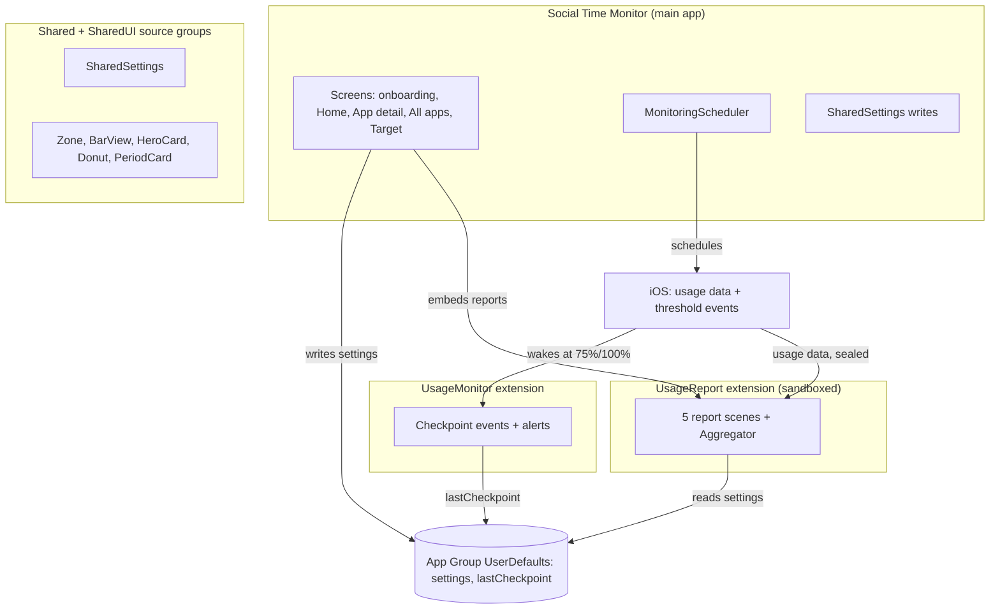

# SMAPP — Social Time Monitor

A native iPhone app that shows how long you actually spend on screen in TikTok,
Instagram, X, YouTube and any other app you choose, with an optional per-app
target, colour-zoned charts (green / amber / red) and one overall target.

Built with SwiftUI on Apple's Screen Time APIs (FamilyControls + DeviceActivity).
Everything stays on the device: no account, no server, no analytics.

## How the pieces fit

Usage figures exist only inside `UsageReport`; the main app and `UsageMonitor`
never hold them.

## Folder map

| Path | What it is |
| --- | --- |
| `project.yml` | XcodeGen definition (three targets + Core package) |
| `Packages/Core/` | Pure logic — `swift test` runs anywhere, no Xcode needed |
| `App/` | Main app target (SwiftUI screens, scheduler, notifications) |
| `UsageReport/` | Device Activity Report extension (draws all usage figures) |
| `UsageMonitor/` | Device Activity Monitor extension (threshold alerts) |
| `Shared/`, `SharedUI/` | Source groups compiled into the app + report extension |
| `Config/` | Info.plists, entitlements, privacy manifest |
| `design/` | The approved screen designs and mock-up references |
| `docs/` | CI, portal steps, App Store documents, device checks |

## Working on it

- **Core tests** (no Xcode needed): `swift test --package-path Packages/Core`
- **Generate the project**: `xcodegen generate` → `SocialTimeMonitor.xcodeproj`
- **Cloud build**: every push to `main` compiles all three targets on
  GitHub's macOS runners — see `docs/ci.md`
- **Screenshots**: push with `[screens]` in the head commit message; demo
  mode fills the screens with the mock-up figures

## The pack

Read `00-README-START-HERE.md` first. The specification is
`01-BUILD-SPEC-v2.md`; build order lives in `02-SESSION-TASKS.md` and
`05-RUN-TO-REVIEW.md`; progress and honesty levels are in `PROGRESS.md`;
the review pack for the product owner is `REVIEW.md`.
