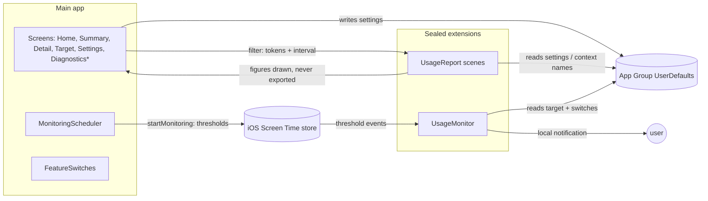

# Architecture

Redrawn 27 November 2026 for the app as built: three targets, the
report contexts (including Part 2's fallback families), the App Group
keys, the feature switches, and what draws what.

## Targets

| Target | Type | Contents |
| --- | --- | --- |
| `SocialTimeMonitor` | application | SwiftUI screens, scheduler, notifications, demo mode, diagnostics (debug) |
| `UsageReport` | DeviceActivity report extension | every scene that draws usage figures (sealed; reads shared settings, writes nothing) |
| `UsageMonitor` | DeviceActivity monitor extension | threshold events → local notifications (Foundation/DeviceActivity/UserNotifications/Core + FeatureSwitches only) |

## The shape

\* Diagnostics is `#if DEBUG` — excluded from release builds.

## Report contexts (what draws what)

| Context | Drawn by | Content |
| --- | --- | --- |
| `homeTotal` | `UsageReport` (`HomeTotalScene`) | Home hero card: total, bar, status |
| `appRow` | `UsageReport` (`AppRowScene`) | one Home row's time + bar |
| `appDetail` | `UsageReport` (`AppDetailScene`) | detail: today card, hourly/week/month chart, stats |
| `summary` | `UsageReport` (`SummaryScene`) | ranked donut + cards |
| `appRows` | `UsageReport` (`AppRowsScene`) | Part 2 fallback: all rows in one report |
| `homeTotal.tNNN.aNN` (×32) | `UsageReport` (`FallbackHomeTotalScene`) | Part 2 fallback: target/amber encoded in the context name |
| `summary.fN` (×8) | `UsageReport` (`SummaryFocusScene`) | Part 2 fallback: host-driven focus |
| `diagnostics` (debug) | `UsageReport` (`DiagnosticsScene`) | Gate A checklist's extension side |

The main app draws: navigation, switches, targets, period tabs and
pills, the day-pill row, the host-driven focus legend, demo mode, and
every icon/name outside the reports (`Label(token)`).

## App Group keys (`group.com.YOURORG.socialtimemonitor`)

| Key | Written by | Read by |
| --- | --- | --- |
| `selection`, `orderedTokens`, `enabledTokens`, `appTargets` | main app | report |
| `monitoringEnabled`, `targetMode`, `targetMinutes`, `amberFraction` | main app | report + monitor |
| `alertsEnabled`, `recapsEnabled`, `weekStartsOn`, `statsPeriod`, `detailToken`, `summaryPeriod`, `summaryDay` | main app | extensions |
| `lastCheckpoint`, `lastAlert`, `lastMonitoringError` | monitor / app | app, diagnostics |
| `diagnosticsTimestamp`, `historyDays` | app / person (Diagnostics) | report, Summary gating |

## Feature switches (`Shared/FeatureSwitches.swift`)

`homeRowsMode` (perRow/single), `summaryFocusMode` (inReport/hostDriven),
`appGroupContextFallback`, `monthlyRequiresHistory` (uses
`historyDays`), `alertsKillSwitch`. Defaults keep today's behaviour;
`docs/gate-a-outcomes.md` maps each Gate A FAIL to its switch.

## Monitoring flow

1. Onboarding authorises (`.individual`) and picks apps
   (`FamilyActivitySelection(includeEntireCategory: true)`).
2. `MonitoringScheduler` runs a repeating midnight-to-midnight
   `DeviceActivitySchedule` with six checkpoint events
   (`pct.25`…`pct.150`, `includesPastActivity: true`); weekly mode
   adds the calendar-week activity. Restarts are debounced; launch
   only tops up missing activities; failures land in
   `lastMonitoringError`.
3. Threshold events wake `UsageMonitor`: sanity guard (class 13-era
   early-fire guard), alert ledger (one per line per interval),
   optional kill switch, local notifications at 75% and 100%.

## Zones and the day boundary

Green under 75% of target, amber 75–100%, red over 100% (per-app
targets use the same fractions). The UK calendar
(`Core.AppCalendar.uk()`, Europe/London) drives the Summary's day
pills, "today" and elapsed fractions, matching the monitor's
schedule-time-zone accrual.

## Websites

v1 counts apps only; the v1.1 opt-in shows web domains as their own
rows, never merged, never alongside browser app tokens
(`docs/monitoring-analysis.md` §5).
